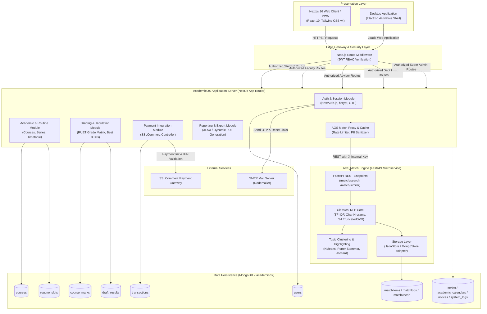

# AcademicOS (AOS) - Complete System Architecture Documentation

**Target Institution:** Rajshahi University of Engineering & Technology (RUET)  
**Target Department:** Department of Electronic and Telecommunication Engineering (ETE)  
**Core Technologies:** Next.js 16 (App Router), React 19, TypeScript 5, Tailwind CSS v4, MongoDB, NextAuth.js, Python 3.10+ (FastAPI, Scikit-learn, NLTK), Electron 44, SSLCommerz, Nodemailer, WeasyPrint  
**Document Purpose:** Comprehensive Architectural & Technical Reference for Academic Project Reports, Thesis Documentation, and System Audits.

---

## Table of Contents
1. [Executive Architectural Summary](#1-executive-architectural-summary)
2. [Multi-Tier System Topology (ASCII Diagram)](#2-multi-tier-system-topology-ascii-diagram)
3. [Mermaid C4 System Architecture Diagram](#3-mermaid-c4-system-architecture-diagram)
4. [Role-Based Access Control (RBAC) & Edge Middleware](#4-role-based-access-control-rbac--edge-middleware)
5. [Application Subsystems & Domain Modules](#5-application-subsystems--domain-modules)
6. [Specialized Microservice: AOS Match Similarity Engine](#6-specialized-microservice-aos-match-similarity-engine)
7. [Data Persistence Architecture: MongoDB Collections & Schemas](#7-data-persistence-architecture-mongodb-collections--schemas)
8. [Domain Business Logic & Academic Algorithms](#8-domain-business-logic--academic-algorithms)
9. [External System & Infrastructure Integrations](#9-external-system--infrastructure-integrations)
10. [Exhaustive API Route Catalog](#10-exhaustive-api-route-catalog)
11. [Complete File-to-Layer System Topology](#11-complete-file-to-layer-system-topology)
12. [Formal TypeScript Architectural Specification](#12-formal-typescript-architectural-specification)

---

## 1. Executive Architectural Summary

**AcademicOS (AOS)** is a modern, full-stack, distributed academic management and research intelligence ecosystem engineered specifically for the Department of Electronic and Telecommunication Engineering (ETE) at RUET.

The architecture solves core operational bottlenecks in university management by integrating:
- **Role-Based Workflows**: Independent dashboards tailored for Students, Faculty, Series Advisors, Department Heads, and Super Administrators.
- **Academic Governance**: Course registration, backlog tracking, automated conflict-free routine scheduling, and dynamic academic calendars.
- **Examination & Result Tabulation**: Dynamic multi-segment mark entry, Best 3 of 4 Class Tests (CT) calculation, RUET regulation grade conversions, and automated backlog grade capping.
- **Integrated Financial Gateway**: Automated student fees and form fill-up billing using SSLCommerz (calculated dynamically per registered credit).
- **AOS Match NLP Microservice**: An LLM-free similarity search and plagiarism deterrence engine utilizing classical NLP (TF-IDF, Character N-Grams, Latent Semantic Analysis via TruncatedSVD, and KMeans clustering) to maintain academic integrity for undergraduate projects (ETE 2200, ETE 3200) and theses (ETE 4100, ETE 4200).
- **Multi-Platform Access**: Responsive Next.js 16 Web Application, installable Progressive Web App (PWA), and native Windows Desktop Application powered by Electron 44.

---

## 2. Multi-Tier System Topology (ASCII Diagram)

```text
========================================================================================================================
                                           ACADEMICOS (AOS) SYSTEM ARCHITECTURE
                               Department of Electronic and Telecommunication Engineering (ETE)
========================================================================================================================

+----------------------------------------------------------------------------------------------------------------------+
| 1. PRESENTATION / CLIENT TIER                                                                                        |
+----------------------------------------------------------------------------------------------------------------------+
|  +-----------------------------------------+                 +-----------------------------------------------------+  |
|  |       Progressive Web App (PWA)         |                 |              Electron Desktop Client                |  |
|  |   - Next.js 16 / React 19 Client Tree   |                 |   - Electron 44 Native Shell (App ID: bd.ac.ruet)   |  |
|  |   - Tailwind CSS v4 / Lucide React Icons|                 |   - Offline Fallback Shell (offline.html)           |  |
|  |   - ThemeProvider / Toast Notifications |                 |   - Desktop Native Menus, Deep Links, NSIS Packager |  |
|  +-----------------------------------------+                 +-----------------------------------------------------+  |
|                                                     |                                                                |
+-----------------------------------------------------|----------------------------------------------------------------+
                                                      | HTTPS / WSS / REST
                                                      v
+----------------------------------------------------------------------------------------------------------------------+
| 2. EDGE GATEWAY, ROUTING & RBAC MIDDLEWARE (Next.js Edge Runtime / middleware.ts)                                    |
+----------------------------------------------------------------------------------------------------------------------+
|  - NextAuth JWT Token Inspection & Session Authentication                                                            |
|  - Multi-Tier Role-Based Route Isolation:                                                                            |
|     * Student Tier    : /dashboard/{registration, form-fillup, results, backlog-registration, calendar, routine}     |
|     * Faculty Tier    : /dashboard/{classes, marks, similarity}                                                      |
|     * Advisor Tier    : /dashboard/{roster, approvals, calendar-builder, tabulation}                                 |
|     * Dept Head Tier  : /dashboard/{series-manager, student-mgmt, head-results, routine-builder}                     |
|     * Super Admin Tier: /dashboard/{faculty-mgmt, user-mgmt, logs, match-vocab}                                      |
+----------------------------------------------------------------------------------------------------------------------+
                                                      |
                                                      v
+----------------------------------------------------------------------------------------------------------------------+
| 3. CORE APPLICATION & BACKEND API TIER (Next.js App Router / Server Functions)                                       |
+----------------------------------------------------------------------------------------------------------------------+
|  +----------------------+ +-------------------------+ +------------------------+ +--------------------------------+  |
|  | Identity & Auth API  | | Examination & Grading   | | Academic Affairs       | | Financial / Payment Gateway    |  |
|  | - NextAuth JWT Auth  | | - Dynamic Mark Segments | | - Course Catalog       | | - SSLCommerz Session Init      |  |
|  | - Brute-force Lock   | | - Best 3/4 CTs Average  | | - Series Progression   | | - IPN Webhooks (Validate/IPN)  |  |
|  | - OTP Verification   | | - RUET GPA/CGPA Matrix  | | - Routine Conflict Det.| | - Credit Calculation (20/cr)   |  |
|  | - Password Recovery  | | - Backlog Cap (B+/3.25) | | - Dynamic Calendar     | | - Transaction State Machine    |  |
|  +----------------------+ +-------------------------+ +------------------------+ +--------------------------------+  |
|                                                     |                                                                |
|  +--------------------------------------------------+-------------------------------------------------------------+  |
|  | Reverse Proxy, In-Memory Caching & Rate Limiting (src/app/api/match/[...path]/route.ts)                         |  |
|  | - In-memory LRU Cache (60s TTL) | Rate Limiter (30 req/min/user) | Role PII Stripper (includePeople Flag)        |  |
|  +----------------------------------------------------------------------------------------------------------------+  |
+----------------------------------------------------------------------------------------------------------------------+
                         |                                                     |
                         | X-Internal-Key (Port 8001)                          | MongoDB Native Driver (Connection Pool)
                         v                                                     v
+---------------------------------------------------+ +----------------------------------------------------------------+
| 4. SPECIALIZED MICROSERVICE: AOS MATCH ENGINE     | | 5. DATA PERSISTENCE TIER (MongoDB: academicos)                 |
|    (Python 3.10+ / FastAPI / Classical NLP)       | +----------------------------------------------------------------+
+---------------------------------------------------+ |  - users               : Credentials, roles, profile, lockouts |
|  - Strict Isolation Pools:                        | |  - series              : Batches, active semester status       |
|    * Project: ETE 2200 / ETE 3200                 | |  - courses             : Theory & Sessional catalog + credits  |
|    * Thesis : ETE 4100 + ETE 4200                 | |  - course_marks        : Segmented mark breakdowns per course  |
|  - Dual Vectorization: TF-IDF (1-2g) + Char n-gram| |  - draft_results       : Tabulated semester GPAs / CGPAs       |
|  - Dimensionality Reduction: TruncatedSVD (LSA)   | |  - academic_calendars  : Semester schedules, events & breaks   |
|  - Unsupervised Grouping: KMeans Topic Clustering | |  - routine_slots       : Timetable day/room/period slots       |
|  - Text Utilities: Porter Stemmer, Jaccard Syns,  | |  - transactions        : SSLCommerz transaction audits         |
|    Sentence Span Highlighting (difflib)           | |  - matchitems          : Normalized project/thesis repository  |
|  - Dual Persistence Store: JSON File / MongoStore | |  - matchlogs           : Search telemetry & query frequencies  |
|  - Automated Ingestion: Excel Multi-group Importer| |  - matchvocab          : Domain-specific synonyms & stopwords  |
+---------------------------------------------------+ |  - notices             : Department announcements & circulars  |
                                                      |  - system_logs         : Comprehensive RBAC audit logs         |
                                                      +----------------------------------------------------------------+
                                                                                       ^
+--------------------------------------------------------------------------------------+-------------------------------+
| 6. THIRD-PARTY INFRASTRUCTURE & REPORT GENERATION ENGINES                                                            |
+----------------------------------------------------------------------------------------------------------------------+
|  - Payment Processor: SSLCommerz Payment Gateway (Sandbox & Production APIs)                                         |
|  - Mail Service     : Nodemailer (SMTP Transporter for 2FA, OTPs, and password reset dispatches)                     |
|  - Document Engines : WeasyPrint (Python) / Custom Headless HTML-to-PDF / SheetJS (Excel Marks & Tabulation Export)   |
+----------------------------------------------------------------------------------------------------------------------+
```

---

## 3. Mermaid C4 System Architecture Diagram



---

## 4. Role-Based Access Control (RBAC) & Edge Middleware

Authentication is verified at the edge runtime via `middleware.ts` leveraging encrypted NextAuth JWT tokens. Access control is segmented into 5 distinct operational tiers:

| Tier | Role Key | Permitted Dashboard Paths | Key Permissions |
|---|---|---|---|
| **Student** | `student` | `/dashboard/registration`<br/>`/dashboard/form-fillup`<br/>`/dashboard/results`<br/>`/dashboard/backlog-registration`<br/>`/dashboard/calendar`<br/>`/dashboard/routine` | Course registration, online fees payment, semester routine view, calendar download, personal semester grade sheet. |
| **Faculty** | `faculty` | `/dashboard/classes`<br/>`/dashboard/marks`<br/>`/dashboard/similarity` | View assigned teaching classes, download mark upload templates (Excel), upload segmental marks, thesis similarity lookup. |
| **Course Advisor** | `advisor` | `/dashboard/roster`<br/>`/dashboard/approvals`<br/>`/dashboard/calendar-builder`<br/>`/dashboard/tabulation`<br/>*(Inherits Faculty routes)* | Approve student course registrations, construct academic calendar, compile series results, generate official tabulation sheets. |
| **Department Head** | `dept_head` | `/dashboard/series-manager`<br/>`/dashboard/student-mgmt`<br/>`/dashboard/head-results`<br/>`/dashboard/routine-builder`<br/>*(Inherits Advisor & Faculty routes)* | Promote academic series, course allocation, routine scheduling matrix, final approval & publication of semester results. |
| **Super Admin** | `admin` | `/dashboard/faculty-mgmt`<br/>`/dashboard/user-mgmt`<br/>`/dashboard/logs`<br/>`/dashboard/match-vocab` | Account provisioning, role assignments, system-wide audit logs, similarity vocabulary management. Bypass on all routes. |

---

## 5. Application Subsystems & Domain Modules

### 5.1 Presentation Subsystem
- **Web PWA Client**: Built on React 19 and Next.js 16 App Router. Features dark/light themes via `next-themes`, real-time toast feedback via `react-hot-toast`, and styled with Tailwind CSS v4.
- **Desktop Client**: Built on Electron 44 (`desktop/main.js`). Features custom window frames, native application menus, automatic failover to local offline shell (`desktop/offline.html`), and zero-install client builds packaged via NSIS (`AcademicOS-Setup-1.0.0.exe`).

### 5.2 Academic Affairs Subsystem
- **Series & Curriculum Manager**: Tracks undergraduate batches (Series 19, 20, 21, 22, etc.) and their current semester progress (1-1 through 4-2).
- **Routine Engine**: A grid-based timetable builder mapping days (Sunday to Thursday) and 8 period slots to rooms and instructors. Enforces room and teacher conflict checks.
- **Calendar Engine**: Visual interactive calendar builder allowing advisors to define instructional weeks, preparatory leave, semester finals, and vacations.

### 5.3 Examination & Tabulation Subsystem
- **Dynamic Segment Allocator (`markSegments.ts`)**: Generates custom evaluation components depending on whether a course is Theory, Sessional/Lab, or special Project/Thesis.
- **Excel Ingestion Engine (`xlsx`)**: Instructors can upload bulk marks via standardized spreadsheet templates with automated format and roll validation.
- **Result Compiler (`/api/advisor/compile-result`)**: Aggregates continuous assessments, applies Best 3/4 Class Test logic, merges semester final scores, applies RUET grade boundaries, and tabulates final GPAs and CGPAs.

### 5.4 Financial Subsystem
- **SSLCommerz Integration**: Student semester fees and examination form fill-up fees are dynamically calculated at **20 BDT per registered credit hour**.
- **Transaction Safety**: Generates unique transaction records (`transactions` collection). Supports Instant Payment Notification (IPN), success redirects, failure fallbacks, and cancellation handling.

---

## 6. Specialized Microservice: AOS Match Similarity Engine

The **AOS Match Engine** is an isolated, LLM-free similarity search microservice designed to evaluate undergraduate project ideas and thesis abstracts against historical archives to prevent duplicative work.

### 6.1 Architectural Principles & Guardrails
1. **Zero LLM / Zero External API**: Exclusively utilizes deterministic classical NLP algorithms (TF-IDF, Character N-Grams, LSA, Porter Stemmer).
2. **Strict Pool Isolation**: Documents are partitioned into strict search pools:
   - `project / ETE 2200`
   - `project / ETE 3200`
   - `thesis / ETE 4200` (combines 4100 and 4200)
   *Cross-pool leakage is strictly prohibited.*
3. **Privacy & PII Protection**: Author names and student rolls are stripped unless queried by authenticated staff members (`includePeople=true`).
4. **Performance Targets**: Sub-50ms query latency across thousands of historical projects.

### 6.2 NLP Processing Pipeline

```text
Raw Query Input (2 - 4000 chars)
  │
  ├── 1. Text Normalization: Regex cleansing, lowercase conversion, alphanumeric extraction
  ├── 2. Stopword Filtering: Comprehensive domain-specific stopword elimination
  ├── 3. Stemming: NLTK PorterStemmer reduces tokens to morphological roots
  ├── 4. Dual Vectorization:
  │      ├─ Word-Level TF-IDF: Unigram & Bigram matrix (ngram_range=(1,2))
  │      └─ Char-Level TF-IDF: Sub-word character n-grams (ngram_range=(3,5)) for typo resilience
  ├── 5. Dimensionality Reduction: TruncatedSVD (Latent Semantic Analysis - LSA)
  ├── 6. Clustering: KMeans unsupervised cluster modeling for topic categorization
  └── 7. Scoring & Alignment:
         ├─ Cosine Similarity Metric calculation
         ├─ Best sentence isolation using sequence matching (difflib)
         └─ UI span highlight offset computation
```

---

## 7. Data Persistence Architecture: MongoDB Collections & Schemas

The database layer runs on MongoDB (`academicos` database) accessed through cached connection pooling in `src/lib/mongodb.ts`.

### 7.1 Collection Inventory

| # | Collection Name | Purpose & Domain | Key Indexes |
|---|---|---|---|
| 1 | `users` | User credentials, roles, lockout counters, OTP secrets, series. | `email` (unique), `studentId`, `role` |
| 2 | `series` | Academic batch configurations, current semester, advising faculty. | `series` (unique), `status` |
| 3 | `courses` | Complete course catalog, credit hours, course types (theory/sessional). | `courseCode` (unique), `offeredSemester` |
| 4 | `course_marks` | Segmented mark documents per course, series, and instructor. | `courseCode_1_series_1_segment_1` |
| 5 | `draft_results` | Tabulated semester results, compiled GPAs/CGPAs, publication status. | `series_1_semester_1` |
| 6 | `academic_calendars`| Term dates, preparatory leaves, examination periods, vacations. | `series_1_semester_1` |
| 7 | `routine_slots` | Timetable day/period/room/instructor assignment slots. | `series_1_day_1_periodIndex_1` |
| 8 | `transactions` | SSLCommerz payment audit records, transaction IDs, statuses. | `tran_id` (unique), `studentRoll` |
| 9 | `matchitems` | Indexed historical project/thesis abstracts for AOS Match. | `id` (unique), `course`, `series` |
| 10| `matchlogs` | Telemetry logs for similarity searches and query analytics. | `timestamp`, `userId` |
| 11| `matchvocab` | Domain-specific synonyms, stopword lists, and term weights. | `word` (unique), `type` |
| 12| `notices` | Department circulars, announcements, and attachments. | `createdAt`, `targetAudience` |
| 13| `system_logs` | Audit trail for security actions, role changes, and system events. | `timestamp`, `userId`, `action` |

---

## 8. Domain Business Logic & Academic Algorithms

### 8.1 RUET Grading System with Backlog Interceptor
The system implements the official RUET academic grading scale. Crucially, the **Backlog Interceptor** caps any cleared backlog course at a maximum grade of **B+ (3.25)**, regardless of whether the numerical mark scored higher:

$$\text{GradePoint}(M) = 
\begin{cases} 
4.00 \ (\text{A+}) & \text{if } M \ge 80 \\
3.75 \ (\text{A})  & \text{if } 75 \le M < 80 \\
3.50 \ (\text{A-}) & \text{if } 70 \le M < 75 \\
3.25 \ (\text{B+}) & \text{if } 65 \le M < 70 \\
3.00 \ (\text{B})  & \text{if } 60 \le M < 65 \\
2.75 \ (\text{B-}) & \text{if } 55 \le M < 60 \\
2.50 \ (\text{C+}) & \text{if } 50 \le M < 55 \\
2.25 \ (\text{C})  & \text{if } 45 \le M < 50 \\
2.00 \ (\text{D})  & \text{if } 40 \le M < 45 \\
0.00 \ (\text{F})  & \text{if } M < 40 
\end{cases}$$

$$\text{FinalGradePoint}(M, \text{isBacklog}) = 
\begin{cases}
\min(3.25, \text{GradePoint}(M)) & \text{if } \text{isBacklog} = \text{true} \\
\text{GradePoint}(M) & \text{otherwise}
\end{cases}$$

### 8.2 Theory Best 3 of 4 Class Tests Average
For theory courses, 4 Class Tests are administered. The lowest score is automatically dropped:

$$\text{CT Score} = \frac{1}{3} \sum_{i=1}^{3} \text{descending}(\text{CT}_1, \text{CT}_2, \text{CT}_3, \text{CT}_4)[i]$$

### 8.3 Dynamic Evaluation Segments (`src/lib/markSegments.ts`)

| Course Type / Code | Allocated Evaluation Segments |
|---|---|
| **Undergraduate Projects (2200 / 3200)** | `Supervisor`, `Showcase`, `Board Viva` |
| **Seminar (3218)** | `Supervisor`, `Seminar 1`, `Seminar 2` |
| **Thesis Part I (4100)** | `Supervisor`, `Pre Defense`, `Board Viva` |
| **Thesis Part II (4200)** | `Supervisor`, `Defense`, `Board Viva` |
| **Regular Theory (Single Teacher)** | `Class Tests (4)`, `Assignment`, `Attendance`, `Semester Final (Full)` |
| **Regular Theory (Dual Teachers)** | `Class Tests (2)`, `Assignment`, `Attendance`, `Semester Final (Part)` |
| **Sessional / Laboratory Courses** | `Attendance`, `Quiz`, `Lab Report`, `Performance`, `Lab Viva`, `Lab Final`, `Board Viva` |

---

## 9. External System & Infrastructure Integrations

1. **SSLCommerz Payment Gateway**:
   - Integrated via `sslcommerz-lts`.
   - Sandbox URL: `https://sandbox.sslcommerz.com/gwprocess/v4/api.php`
   - Secure Production URL: `https://securepay.sslcommerz.com/gwprocess/v4/api.php`
   - Validation API: `https://sandbox.sslcommerz.com/validator/api/validationserverAPI.php`
   - Calculates charges at **20 BDT per credit** for registration and semester form fill-up.
2. **Nodemailer SMTP Mailer**:
   - Handles password reset email dispatches, 2FA OTP codes, and academic notifications.
3. **Document Export Subsystems**:
   - **SheetJS (`xlsx`)**: Dynamic Excel template generation and mark parsing.
   - **WeasyPrint / Custom PDF Engine**: High-fidelity HTML-to-PDF rendering for official Grade Sheets, Tabulation Sheets, Class Routines, and Academic Calendars.

---

## 10. Exhaustive API Route Catalog

```text
/api/
├── admin/
│   ├── faculty/                 # Manage department faculty records
│   ├── logs/                    # Retrieve and filter system audit trail
│   ├── match-vocab/             # View and update NLP domain synonyms/stopwords
│   ├── overview/                # System telemetry and operational metrics
│   └── users/                   # User CRUD, credential resets, role assignments
│
├── advisor/
│   ├── calendar/                # Create, update, and manage series academic calendars
│   │   └── pdf/                 # Export formatted calendar as PDF
│   ├── compile-result/          # Calculate GPAs, Best 3 CTs, apply backlog caps
│   ├── match-import/            # Upload and preview project/thesis Excel records
│   ├── match-import-data/       # Retrieve historical match dataset
│   ├── match-import-status/     # Check batch import execution status
│   ├── roster/                  # Student list, registration approvals per series
│   └── tabulation-pdf/          # Generate official academic tabulation sheet PDF
│
├── auth/
│   ├── [...nextauth]/           # NextAuth JWT session provider and callbacks
│   ├── forgot-password/         # Generate OTP for password recovery
│   ├── login/                   # Credential authentication with brute-force protection
│   ├── reset-password/          # Validate reset token and update password hash
│   ├── setup/                   # First-time account profile completion
│   └── verify-otp/              # Verify two-factor OTP credentials
│
├── faculty/
│   ├── marks-dashboard/         # Overview of submission status across assigned courses
│   ├── match-items/             # Search project/thesis archives with author names
│   ├── my-classes/              # Courses assigned to the authenticated teacher
│   ├── template/                # Download customized Excel marks template
│   ├── upload-marks/            # Upload segmented course assessment marks
│   └── upload-marks-unified/    # Upload complete course marks in single spreadsheet
│
├── head/
│   ├── course-allocation/       # Assign courses to specific teachers
│   ├── courses/                 # Department curriculum catalog management
│   ├── faculty-list/            # Faculty directory and workload metrics
│   ├── overview/                # Department metrics, series health, enrollment
│   ├── results/                 # Review compiled results, publish to students
│   ├── series/                  # Manage academic series, activate/promote semesters
│   └── students/                # Complete student registry and status overrides
│
├── match/
│   └── [...path]/               # Reverse Proxy to Python FastAPI AOS Match Engine
│                                # Handles /scopes, /search, /similar, /topics, /reindex
│
├── notices/                     # Department announcements and circulars CRUD
├── payment/
│   ├── init/                    # Initialize SSLCommerz registration payment
│   ├── success/                 # Payment success callback & IPN validation
│   ├── fail/                    # Payment failure handler
│   ├── cancel/                  # Payment cancellation handler
│   └── form-fillup/             # Dedicated payment flow for examination form fill-up
│       ├── init/
│       ├── success/
│       ├── fail/
│       └── cancel/
│
├── routine/
│   ├── route.ts                 # Routine slots CRUD & timetable query
│   ├── faculty/                 # Routine filtered by instructor initials
│   └── pdf/                     # Official class routine timetable PDF generator
│
├── student/
│   ├── backlog-registration/    # Apply for backlog examination courses
│   ├── calendar/                # Retrieve series-specific academic calendar
│   │   └── pdf/                 # Download academic calendar PDF
│   ├── form-fillup/             # Apply for regular semester examination
│   ├── registration/            # Regular semester course enrollment
│   ├── results/                 # View student published semester results and CGPA
│   └── routine/                 # View student personalized weekly routine
│
└── user/
    └── settings/
        ├── otp/                 # 2FA configuration
        ├── password/            # Authenticated password update
        └── profile/             # Profile details, phone number update
```

---

## 11. Complete File-to-Layer System Topology

```text
d:\3-2\academicos\
│
├── desktop/                                     # PRESENTATION TIER: ELECTRON DESKTOP CLIENT
│   ├── assets/                                  # App icons and graphics
│   ├── build/                                   # Installer build resources & Windows NSIS config
│   ├── main.js                                  # Electron main process (lifecycle, IPC, window management)
│   ├── offline.html                             # Offline fallback shell when server is unreachable
│   └── package.json                             # Electron 44 & electron-builder packaging config
│
├── match_engine/                                # NLP MICROSERVICE TIER: AOS MATCH ENGINE (Python/FastAPI)
│   ├── aos_match/
│   │   ├── __init__.py                          # Package initialization
│   │   ├── api.py                               # FastAPI REST endpoints, auth, and error handlers
│   │   ├── config.py                            # NLP hyper-parameters, thresholds, file paths
│   │   ├── engine.py                            # TF-IDF, Char n-grams, LSA TruncatedSVD, KMeans logic
│   │   ├── evaluate.py                          # Metric evaluator (P@k, R@10, MRR benchmarking)
│   │   ├── importer.py                          # Robust Excel parser & group thesis deduplicator
│   │   ├── pdf_service.py                       # WeasyPrint PDF compilation bridge
│   │   ├── store.py                             # Persistence abstraction (JsonStore vs MongoStore)
│   │   ├── tagger.py                            # Automatic keyword & domain tagging
│   │   └── text_utils.py                        # Porter stemmer, stopword dictionaries, span highlighters
│   ├── tests/                                   # Pytest test suite with mongomock
│   ├── cli.py                                   # Standalone CLI for testing search and indexing
│   ├── Makefile                                 # Build automation (serve, test, eval, import)
│   └── requirements.txt                         # Python dependencies (scikit-learn, fastapi, pymongo)
│
├── src/                                         # CORE APPLICATION TIER: Next.js 16 Fullstack
│   ├── app/
│   │   ├── (auth)/                              # User authentication routes
│   │   ├── api/                                 # Server REST API controllers
│   │   ├── components/                          # Reusable UI component library
│   │   │   ├── dashboard/                       # Sidebar, Topbar, DashboardSwitcher, Role views
│   │   │   │   └── views/                       # AdminView, DeptHeadView, FacultyView, StudentView
│   │   │   ├── home/                            # Landing page sections, hero banners, feature showcases
│   │   │   ├── AuthProvider.tsx                 # NextAuth SessionProvider wrapper
│   │   │   ├── DropdownFilter.tsx               # Standardized data filtering dropdowns
│   │   │   ├── Footer.tsx                       # Global system footer
│   │   │   ├── Navbar.tsx                       # Global responsive navigation bar
│   │   │   ├── Pagination.tsx                   # Standardized table pagination controls
│   │   │   ├── PwaRegister.tsx                  # Service Worker / PWA installer hook
│   │   │   ├── ThemeProvider.tsx                # NextThemes dark/light mode controller
│   │   │   └── ToastProvider.tsx                # React Hot Toast alert provider
│   │   ├── dashboard/                           # 26 Role-protected feature modules
│   │   ├── courses/                             # Public academic course catalog
│   │   ├── match/                               # Public/authenticated similarity search portal
│   │   ├── notice/                              # Department noticeboard
│   │   ├── routine/                             # Department public routine browser
│   │   ├── globals.css                          # Tailwind CSS v4 styling rules
│   │   ├── layout.tsx                           # Root HTML shell with Theme & Auth providers
│   │   ├── manifest.ts                          # Web App Manifest for PWA installation
│   │   └── page.tsx                             # System landing page
│   │
│   ├── lib/                                     # BUSINESS LOGIC & UTILITIES
│   │   ├── auth.ts                              # NextAuth configuration, credentials provider, lockout
│   │   ├── logger.ts                            # Audit logger persisting to `system_logs`
│   │   ├── mail.ts                              # Nodemailer SMTP transporter & templates
│   │   ├── markSegments.ts                      # Single source of truth for course mark segment patterns
│   │   ├── mongodb.ts                           # Cached MongoDB client connection pool
│   │   └── pdf/                                 # Headless browser / PDF generation routines
│   │
│   └── types/                                   # TYPESCRIPT TYPE DEFINITIONS
│       ├── match.ts                             # Search query & response interfaces
│       └── next-auth.d.ts                       # NextAuth session & JWT type augmentations
│
├── middleware.ts                                # EDGE ROUTING & RBAC AUTHORIZATION MIDDLEWARE
├── package.json                                 # Node.js dependencies & scripts
├── next.config.ts                               # Next.js build and routing options
├── tsconfig.json                                # TypeScript configuration
└── scripts/                                     # SEEDING & NLP MAINTENANCE
    ├── calibrate.py                             # NLP similarity calibration script
    ├── seed-courses.ts                          # ETE curriculum course catalog seeder
    ├── seed.ts                                  # Initial users & department series seeder
    └── suggest_synonyms.py                      # Lexical synonym generation assistant
```

---

## 12. Formal TypeScript Architectural Specification

```typescript
/**
 * AcademicOS Architecture Definition Contract
 */
export namespace AcademicOS {
  export type UserRole = "student" | "faculty" | "advisor" | "dept_head" | "admin";

  export interface User {
    _id: string;
    email: string;
    name: string;
    role: UserRole;
    isAdmin: boolean;
    studentId?: string;
    series?: string;
    initials?: string;
    department: "ETE" | string;
    advising_series?: string;
  }

  export interface MarkCompilationRequest {
    series: string;
    semester: string;
    isBacklog?: boolean;
  }

  export interface MatchSearchRequest {
    type: "project" | "thesis";
    course?: "2200" | "3200";
    query: string;
    topK: number;
    minScore: number;
    includePeople: boolean;
  }

  export interface MatchResultItem {
    id: string;
    title: string;
    course: string;
    series: string;
    score: number;
    bestSentence: string;
    highlightSpans: [number, number][];
    sharedTerms: string[];
    students?: Array<{ name: string; roll: string }>;
  }
}
```
